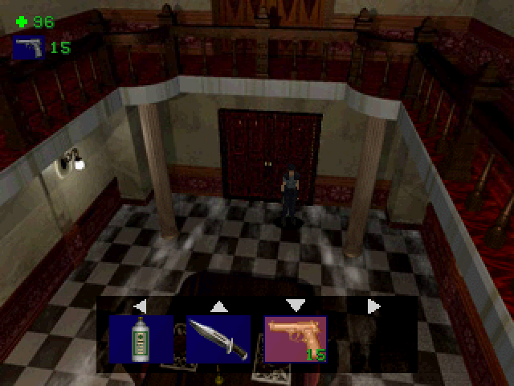
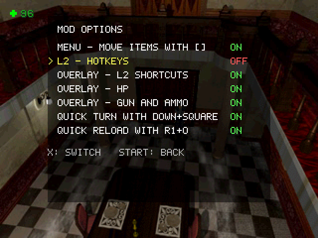
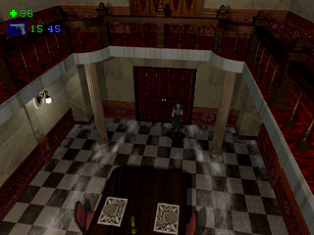
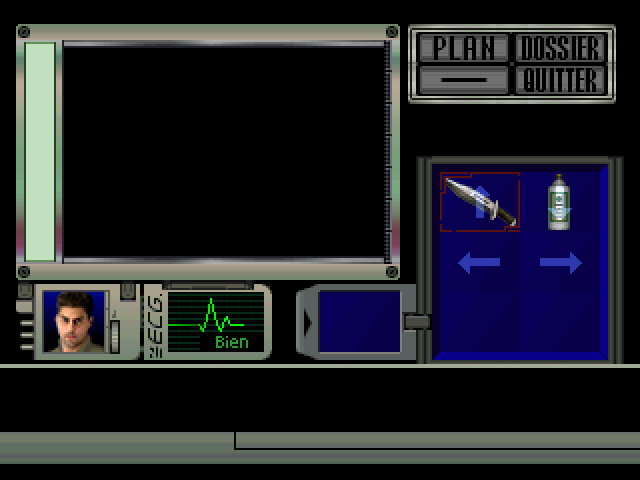
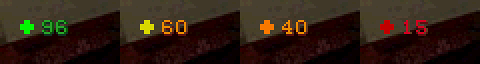

# Resident Evil Director's Cut — Cases rapides, HUD et demi-tour (PS1)

*[English version](README.md) · [Historique des versions](CHANGELOG.fr.md) · [Patcheur en ligne](https://soaresden.github.io/re1-dc-hotkeys/)*

Un mod de gameplay pour **Resident Evil – Director's Cut (PlayStation)** qui ajoute du confort moderne sans toucher à une seule texture :

- **Cases rapides L2 + croix** : équiper une arme ou se soigner sans ouvrir l'inventaire
- **Overlay des cases rapides** : en maintenant L2, les quatre cases en bas de l'écran
- **Vie** en haut à gauche, dans la couleur de l'état du jeu (Bien / Attention / Danger)
- **Arme équipée et munitions** sous la vie : balles chargées, et munitions de ce type portées (toutes les piles additionnées)
- **Demi-tour** : Carré + Bas, comme dans RE3
- **Rechargement rapide** : R1 + Rond remplit l'arme équipée avec les munitions portées
- **Déplacer les objets dans l'inventaire** : Carré pour prendre un objet, Carré pour l'échanger avec un autre
- **Menu d'options en jeu** : maintiens Select 5 secondes, le jeu se fige sur sa dernière image et tu actives ou désactives chaque option

Chaque option s'active ou se désactive dans le patcheur, et en jeu avec le menu d'options.

| En jeu (L2 maintenu) | Menu d'options (Select maintenu 5 s) |
|---|---|
|  |  |

| Arme, balles chargées + munitions portées | Inventaire : Carré déplace les objets, flèches sur les cases rapides |
|---|---|
|  |  |



### Versions prises en charge

| Version | Code | Image d'origine |
|---|---|---|
| Resident Evil – Director's Cut (France) | SLES-00970 | .bin Redump, SHA1 `5d9d1ea07595ae468ba4183a73331f0dace2384e` |
| Resident Evil – Director's Cut (USA) | SLUS-00551 | .bin, SHA1 `d926cec7ac6a1665cc00039ab92dee6a6bebe824` |
| Resident Evil – Director's Cut – Dual Shock Ver. (USA) | SLUS-00747 | .bin unique (720 Mo, SHA1 `e5d1612ead98cdd0f21232cfa914fc62771025ee`) ou le .bin Redump *(Track 1)* |

Le patcheur reconnaît la version tout seul. Les autres éditions (Europe en anglais, Allemagne, Japon…) demandent un portage des adresses du jeu : voir [Autres versions](#autres-versions).

## Installer

### Option 1 : le patcheur (conseillé)

Ouvre **[le patcheur en ligne](https://soaresden.github.io/re1-dc-hotkeys/)** (ou télécharge [`patcher/RE1-Hotkeys-Patcher.html`](patcher/RE1-Hotkeys-Patcher.html) et ouvre-le hors ligne ; choix français / anglais en haut à droite), puis :

1. choisis ton `.bin` d'origine (la version est détectée) ;
2. coche les options voulues ;
3. télécharge le **.bin patché (+ .cue)** ou un **.ppf**.

Tout se passe dans le navigateur, rien n'est envoyé. Le patcheur ne contient aucune donnée du jeu : il lit l'exécutable sur ton image et reconstruit les secteurs (EDC/ECC compris).

**DuckStation avec un .ppf :** active *Réglages → Console → Apply Image Patches* et place le `.ppf` à côté de l'image d'origine, avec le même nom (`Mon jeu.bin` → `Mon jeu.ppf`). Ça marche aussi avec un `.chd` du même jeu.

**Seulement un .chd ?** Extrais d'abord le `.bin` : `chdman extractcd -i jeu.chd -o jeu.cue -ob jeu.bin`.

### Option 2 : xdelta (toutes les options)

Applique le xdelta de ta version, dans [`patch/`](patch/), sur le `.bin` d'origine avec xdelta3, Delta Patcher ou un autre outil xdelta. Pour la version Dual Shock, le xdelta est fait pour le .bin unique de 720 Mo (par exemple extrait d'un .chd) ; avec un fichier Redump *(Track 1)*, passe par le patcheur.

## Commandes

| Où | Touche | Effet |
|---|---|---|
| En jeu | **L2 + ↑ / ↓ / ← / →** | utilise la case 1 / 2 / 3 / 4 : une arme est équipée, un soin (spray, plantes, mélanges, sérum) est utilisé |
| En jeu | **L2** maintenu | overlay des cases ; la croix ne fait plus marcher |
| En jeu | **Carré + Bas** | demi-tour |
| En jeu | **R1 + Rond** | recharge l'arme équipée jusqu'à sa capacité (Beretta 15, fusil / Colt / bazooka 6) avec les munitions de ce type portées |
| En jeu | **Select** maintenu 5 s | menu d'options : **Haut / Bas** choisir, **Croix** (ou Gauche / Droite) changer, **Start** (ou Triangle / Select) retour au jeu |
| Inventaire | **Carré** sur un objet, puis **Carré** sur un autre | les échange (l'arme équipée suit son objet) ; Carré sur le même objet ou la fermeture du menu annule |

Les cases rapides sont les quatre cases du haut de l'inventaire (le carré 2×2) ; le mod dessine une flèche translucide sur chacune.

## Limites

- Pas d'action rapide en visée, pendant une animation (escalier, ramassage, porte), une cinématique, ni quand le perso est au sol.
- Carré n'échange que deux cases occupées : le jeu exige un inventaire sans trou.
- L'affichage est masqué dans les menus, les cinématiques et les portes.
- Les changements du menu d'options ne sont pas sauvegardés : le choix du patcheur revient au démarrage suivant.
- Testé avec Jill sur les trois versions dans PCSX-Redux (OpenBIOS ; démarrage vérifié aussi avec le BIOS Sony SCPH-5502), et la version FR sur émulateur avec un BIOS Sony. Pas encore testé sur console, ni avec Chris (6 cases) et Rebecca : les retours sont les bienvenus.

## Fonctionnement

- Un bloc de code de 6 Ko est chargé en `0x8000E800`, dans la mémoire noyau que le BIOS réserve sans l'utiliser (le tas du noyau Sony s'arrête à `0xE600` avec les réglages de ce jeu). L'en-tête de l'exécutable charge l'image à cette adresse sans changer la taille du fichier ; les 6 derniers Ko de l'image d'origine sont reconstruits au démarrage à partir de segments stockés dans le bloc.
- Trois appels du jeu sont redirigés : la boucle principale après la lecture de la manette (commandes), le dessin de la grille d'inventaire (flèches, surbrillance), et la boucle principale une fois la table d'affichage de l'image terminée (HUD, overlay).
- Le HUD et l'overlay sont des primitives GPU construites par le mod, avec des textures que le jeu garde en VRAM pendant la partie (chiffres de l'inventaire, cache d'icônes d'objets).
- Le changement d'arme tourne dans une tâche du jeu, comme l'inventaire. Les sons de l'arme passent par le tampon du modèle d'arme au lieu du tampon qu'utilise l'inventaire : en jeu, celui-ci contient la copie du décor de la salle, et y charger quoi que ce soit laisse des stries en haut de l'écran.
- Chaque option est un octet de la table `config` au début du bloc, écrit par le patcheur et changé par le menu d'options.
- Le menu d'options et l'overlay sont dans une deuxième zone : du code du jeu que rien ne peut atteindre (fonctions de bibliothèque jamais appelées, trouvées par `tools/re/deadcode.py` et vérifiées dans l'émulateur). La police du menu est la nôtre (`src/font.py`), chargée en VRAM le temps du menu (la VRAM qu'elle couvre est sauvegardée puis remise). L'image figée est copiée dans la copie du décor que le jeu redessine à chaque image ; à la sortie, le jeu recharge le vrai décor, comme après l'inventaire.

Organisation des sources (`src/`) :

| Fichier | Contenu |
|---|---|
| `hotkey.S` | démarrage, `config`, les trois accroches |
| `lib.S` | tests d'état du jeu, primitives GPU, nombres |
| `feat_menu_move.S`, `feat_quickslots.S`, `feat_overlay.S`, `feat_hud.S`, `feat_quickturn.S`, `feat_options.S` | un fichier par option, à réutiliser librement |
| `font.py` | la police 5x7 du menu d'options |
| `game.h` | ce que le mod utilise du jeu (noms, champs, constantes) |
| `versions.py` | les adresses de chaque version + constantes du disque (`version.h` en est généré) |
| `build.py` | toute la construction |
| `patcher/core.js`, `patcher/patcher.html` | le patcheur (navigateur et Node) |

[`CLAUDE.md`](CLAUDE.md) contient les notes de recherche détaillées (adresses, pièges, banc de test).

## Construire

Prérequis : Python 3, Node, une toolchain GNU MIPS, chdman et xdelta3. Sous Windows, dans `tools/` :

- `tools/mips/` : `gcc-mipsel-none-elf-12.3.0-windows.zip` des [releases PSn00bSDK](https://github.com/Lameguy64/PSn00bSDK/releases) (sous Linux, `binutils-mips-linux-gnu` + `cpp` conviennent) ;
- `tools/chdman/chdman.exe` : de MAME ;
- `tools/xdelta/xdelta3-*.exe` : [xdelta3 3.0.11](https://github.com/jmacd/xdelta-gpl/releases).

Place les images d'origine à la racine (noms de CHD de `src/versions.py`, par exemple `Resident Evil - Director's Cut (USA).chd`) ou leur `.bin` en `build/<version>/orig.bin` (`fr`, `us`, `usds`), puis :

```
python src/build.py              # toutes les versions trouvées : bloc, BIN/CUE patchés, xdelta, patcheur
python src/build.py --ver us     # une seule version
python src/build.py --asm        # seulement les blocs de code
python src/build.py --chd        # avec les CHD patchés
node tools/test_patcher.js       # le patcheur JS doit produire les mêmes octets que Python
```

Le banc de test (`tools/emu-tests/`) pilote PCSX-Redux avec des scénarios Lua (`run.py <scénario> --ver us`) ; il faut des save states faits soi-même (`launch.py us`, puis `cmd.py "save dining_us"`).

## Autres versions

Chaque version a son propre exécutable, donc toutes les adresses (fonctions, variables, sites d'accroche) diffèrent. `tools/re/port.py` retrouve les adresses françaises dans un autre exécutable : il apparie les fonctions par signature (instructions aux adresses masquées), puis les aligne pour en déduire les adresses des données. Ses résultats doivent être vérifiés à la main (sites d'appel, corps de fonctions, tables retrouvées par leur contenu), puis ajoutés dans `src/versions.py`, avec les constantes du disque (`tools/re/iso.py` donne le LBA et la taille de l'exécutable). L'assembleur refuse un registre de base partagé qui ne serait plus valable dans une version (`SAMEHI`). Les contributions sont les bienvenues, surtout pour l'Europe en anglais (SLES-00969), l'Allemagne et le Japon.

## Crédits

Mod de **soaresden**, avec Claude (Anthropic). Resident Evil est une marque de Capcom ; ce projet n'est pas affilié à Capcom et ne contient aucune donnée du jeu.

Licence : [MIT](LICENSE).
