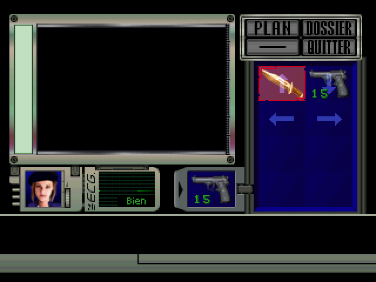

# Resident Evil Director's Cut — Quick slots, HUD & quick turn (PS1)

*[Version française](README.fr.md)*

A gameplay mod for **Resident Evil – Director's Cut (PlayStation)** that adds modern conveniences without touching a single texture:

- **L2 + d-pad quick slots** — equip a weapon or heal without opening the inventory
- **Quick-slot overlay** — hold L2 to see your four quick slots at the bottom of the screen
- **Health display** — top left, in the colour of the game's own condition (Fine / Caution / Danger)
- **Equipped weapon & ammo** — under the health: loaded ammo, and the ammo of that type you carry (all stacks added up)
- **Quick turn** — Square + Down, like in RE3
- **Move items in the inventory** — Square to pick an item up, Square again to swap it with another one
- **In-game options menu** — hold Select for about 3 seconds: the game pauses on its last frame and you switch any of the above on or off

Every feature can be switched on or off in the patcher, and in game with the options menu.

| In game (L2 held) | Inventory |
|---|---|
|  |  |

| Options menu (hold Select) | Weapon, loaded ammo + carried ammo |
|---|---|
|  |  |


### Supported versions

| Version | Serial | Original image |
|---|---|---|
| Resident Evil – Director's Cut (France) | SLES-00970 | Redump .bin, SHA1 `5d9d1ea07595ae468ba4183a73331f0dace2384e` |
| Resident Evil – Director's Cut (USA) | SLUS-00551 | .bin, SHA1 `d926cec7ac6a1665cc00039ab92dee6a6bebe824` |
| Resident Evil – Director's Cut – Dual Shock Ver. (USA) | SLUS-00747 | single .bin (720 MB, SHA1 `e5d1612ead98cdd0f21232cfa914fc62771025ee`) or the Redump *(Track 1)* .bin |

The patcher recognises the version by itself. Other releases (Europe in English, Germany, Japan…) need a port of the game addresses — see [Other versions](#other-versions).

## Install

### Option 1 — the patcher (recommended)

Open **[the online patcher](https://soaresden.github.io/re1-dc-hotkeys/)** (or download [`patcher/RE1-Hotkeys-Patcher.html`](patcher/RE1-Hotkeys-Patcher.html) and open it offline; English / French switch at the top right), then:

1. pick your original `.bin` (the version is detected);
2. tick the features you want;
3. download either the **patched .bin (+ .cue)**, or a **.ppf**.

Everything runs in your browser; nothing is uploaded. The patcher contains no game data: it reads the executable from your own disc image and rebuilds the sectors (EDC/ECC included).

**DuckStation with a .ppf:** enable *Settings → Console → Apply Image Patches* and put the `.ppf` next to the original image, with the same file name (`My Game.bin` → `My Game.ppf`). It also works with a `.chd` of the same game.

**Only have a .chd?** Extract the `.bin` first: `chdman extractcd -i game.chd -o game.cue -ob game.bin`.

### Option 2 — xdelta (all features on)

Apply the [`patch/`](patch/) xdelta of your version to the original `.bin` with xdelta3, Delta Patcher or any xdelta tool. For the Dual Shock version, the xdelta is made for the single 720 MB .bin (e.g. extracted from a .chd); with a Redump *(Track 1)* file, use the patcher.

## Controls

| Where | Input | Effect |
|---|---|---|
| In game | **L2 + ↑ / ↓ / ← / →** | use quick slot 1 / 2 / 3 / 4: a weapon is equipped, a healing item (spray, herbs, mixes, serum) is used |
| In game | hold **L2** | quick-slot overlay; the d-pad no longer moves the character |
| In game | **Square + Down** | 180° quick turn |
| In game | hold **Select** ~3 s | options menu: **Up / Down** choose, **Cross** (or Left / Right) switch, **Start** back to the game |
| Inventory | **Square** on an item, then **Square** on another | swap them (the equipped weapon follows its item); Square on the same item or closing the menu cancels |

The quick slots are the four top cells of the inventory (the 2×2 square); the mod draws a translucent arrow on each of them.

## Limitations

- No quick action while aiming, during animations (stairs, picking up, doors), cutscenes, or when the character is down.
- Square only swaps two occupied cells: the game requires an inventory without holes.
- The on-screen display is hidden in menus, cutscenes and doors.
- The options menu changes are not saved: the patcher's choice comes back at the next boot.
- Tested with Jill on all three versions in PCSX-Redux (OpenBIOS; boot also checked with the Sony SCPH-5502 BIOS), and the FR version on emulator with a Sony BIOS. Not tested on real hardware, nor with Chris (6 slots) and Rebecca yet: reports welcome.

## How it works

- A 6 KB code block is loaded at `0x8000E800`, in kernel memory the BIOS reserves but does not use (the Sony kernel heap ends at `0xE600` with this game's settings). The executable header loads the image there without changing the file size; the last 6 KB of the original image are rebuilt at boot from compressed segments stored in the block.
- Three calls of the game are redirected: the main loop after the pad read (input), the inventory grid draw (arrows, highlight), and the main loop once the frame's ordering table is complete (HUD, overlay).
- The HUD and overlay are GPU primitives built by the mod, using textures the game keeps in VRAM during play (the inventory digits and the item icon cache).
- A weapon swap runs as a game task, like the inventory does. The weapon sounds are loaded through the weapon model buffer instead of the buffer the game uses in the inventory: in game that buffer holds the copy of the room background, and loading there leaves stripes at the top of the screen.
- Each feature is one byte of the `config` table at the start of the block, written by the patcher and switched by the options menu.
- The options menu and the overlay live in a second range: game code that nothing can reach (library functions never called, found by `tools/re/deadcode.py` and checked in the emulator). The menu font is ours (`src/font.py`), loaded into VRAM while the menu is open (the VRAM it covers is saved and put back). The frozen frame is copied into the game's room background copy, which the game redraws every frame; on exit the game reloads the real background, as after the inventory.

Source layout (`src/`):

| File | Content |
|---|---|
| `hotkey.S` | boot, `config`, the three hooks |
| `lib.S` | game state tests, GPU primitives, numbers |
| `feat_menu_move.S`, `feat_quickslots.S`, `feat_overlay.S`, `feat_hud.S`, `feat_quickturn.S`, `feat_options.S` | one file per feature — reuse them freely |
| `font.py` | the 5x7 font of the options menu |
| `game.h` | what the mod uses of the game (names, fields, constants) |
| `versions.py` | the addresses of each version + disc constants (`version.h` is generated from it) |
| `build.py` | the whole build |
| `patcher/core.js`, `patcher/patcher.html` | the patcher (browser and Node) |

[`CLAUDE.md`](CLAUDE.md) holds the detailed research notes (addresses, pitfalls, test bench), in French.

## Build

Requirements: Python 3, Node, a MIPS GNU toolchain, chdman and xdelta3. On Windows, put them in `tools/`:

- `tools/mips/` — `gcc-mipsel-none-elf-12.3.0-windows.zip` from the [PSn00bSDK releases](https://github.com/Lameguy64/PSn00bSDK/releases) (on Linux, `binutils-mips-linux-gnu` + `cpp` work too);
- `tools/chdman/chdman.exe` — from MAME;
- `tools/xdelta/xdelta3-*.exe` — [xdelta3 3.0.11](https://github.com/jmacd/xdelta-gpl/releases).

Put the original images at the root (CHD names of `src/versions.py`, e.g. `Resident Evil - Director's Cut (USA).chd`) or their `.bin` as `build/<version>/orig.bin` (`fr`, `us`, `usds`), then:

```
python src/build.py              # every version found: block, patched BIN/CUE, xdelta, patcher
python src/build.py --ver us     # one version
python src/build.py --asm        # code blocks only
python src/build.py --chd        # also the patched CHDs
node tools/test_patcher.js       # the JS patcher must produce the same bytes as the Python build
```

The test bench (`tools/emu-tests/`) drives PCSX-Redux with Lua scenarios (`run.py <scenario> --ver us`); it needs save states you make yourself (`launch.py us`, then `cmd.py "save dining_us"`).

## Other versions

Each version has its own executable, so every address (functions, variables, hook sites) is different. `tools/re/port.py` finds the French addresses in another executable: it matches functions by signature (instructions with addresses masked), then aligns them to pair the data addresses. Its results must be checked by hand (call sites, function bodies, data tables found by content), then go into `src/versions.py` as a new entry, with the disc constants (`tools/re/iso.py` gives the executable's LBA and size). The assembler refuses a shared base register that is no longer valid in a version (`SAMEHI`). Contributions welcome — especially Europe in English (SLES-00969), Germany and Japan.

## Credits

Mod by **soaresden**, with Claude (Anthropic). Resident Evil is a trademark of Capcom; this project is not affiliated with Capcom and contains no game data.

License: [MIT](LICENSE).
